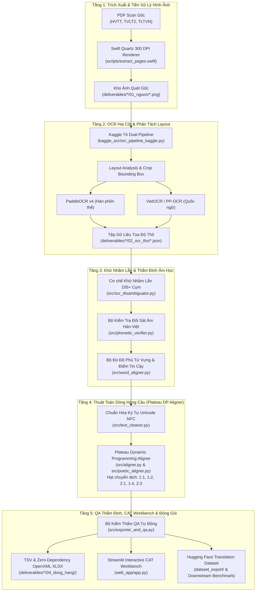

# Hệ Thống Số Hóa, OCR & Dóng Hàng Ngữ Liệu Song Ngữ Hán – Việt
### Sino-Vietnamese Classical OCR, Disambiguation & Parallel Alignment System

[](https://www.python.org/)
[-brightgreen.svg)]()
[]()
[]()
[](https://streamlit.io/)
[]()

---

## 📌 1. Tổng Quan Dự Án (Project Overview)

Dự án xây dựng một hệ thống hoàn chỉnh, khép kín và tự động hóa cao phục vụ công tác **Số hóa tài liệu Hán Nôm**, **Nhận dạng ký tự quang học (OCR)**, **Khử nhầm lẫn tự động nhờ đối soát âm học Hán–Việt**, **Dóng hàng câu song ngữ đa tầng (Parallel Sentence Alignment)**, và **Biên tập CAT Workbench** từ 3 bộ ấn phẩm cổ thi - văn ngôn đồ sộ của văn học trung đại Việt Nam.

Hệ thống giải quyết triệt để các thách thức nan giải trong xử lý văn bản cổ:
1. **Chữ dị thể (Variant Glyphs)** và **chữ khuyết mờ (Historical Lacunae `□`)** từ các bản in mộc bản/bản in lito thế kỷ 19–20.
2. **Các cặp chữ Hán dễ nhầm lẫn thị giác (Visual Confusables)** (`戊/戌/戍`, `己/已/巳`, `日/曰`, `侯/候`, `祇/祗`, `瞻/膽`, `璧/壁`) được giải quyết triệt để bằng cơ chế khử nhầm lẫn định hướng âm học Hán–Việt.
3. **Hiện tượng trôi lệch dóng hàng (Length Drift)** giữa thể thơ ngắn gọn và văn xuôi triết học Phật giáo được khắc phục nhờ thuật toán quy hoạch động dải đều (*Plateau Prior DP Alignment*).
4. **Quy chuẩn chất lượng công nghiệp**: Xuất khẩu đồng thời 2 định dạng `.tsv` và `.xlsx` (chuẩn OpenXML 2 sheet `DONG_HANG` và `THONG_KE` tự tạo không phụ thuộc thư viện bên ngoài), đạt **0.00% lỗi QA** trên toàn bộ các tập kiểm thử.

---

## 🏛️ 2. Ba Bộ Cổ Thư Mục Tiêu (Target Corpora)

Dự án xử lý và chuẩn hóa 3 nguồn tư liệu PDF Scan học thuật chứa văn bản đối chiếu trực tiếp giữa **Nguyên tác chữ Hán** và **Dịch nghĩa / Dịch thơ tiếng Việt**:

| Mã sách | Tên tác phẩm & Tác giả / Biên giả | Nguồn gốc & Ấn bản | Tổng trang PDF | Phạm vi nội dung hợp lệ | Đặc thù cấu trúc & Xử lý ngoại lệ |
| :--- | :--- | :--- | :---: | :---: | :--- |
| **`HVTT`** | **Hán Văn Tinh Túy**<br>*Lãng Nhân Phùng Tất Đắc* | NXB Nam Chi Tùng Thư | 386 trang | **180 trang** (Trang PDF chẵn `8..366`, tương ứng trang sách chẵn `2..360`) | Cấu trúc 4 cột song song (*Chữ Hán, Phiên âm, Dịch nghĩa, Dịch thơ*). Lọc bỏ trang lẻ (*Trích giảng*) và trang 361–375 (*thiếu Dịch nghĩa*). |
| **`TVLT2`** | **Thơ văn Lý – Trần (Tập II)**<br>*GS. Nguyễn Huệ Chi (chủ biên)* | NXB Khoa học Xã hội (1989) | 965 trang | **795 trang** (Trang sách `19..863` / PDF `17..861`) | Văn bia, cổ thi, triết học Phật giáo. Xử lý bổ sung trang scan trắng (`PDF 25` bài *Thiền tông chỉ nam tự*); loại trừ 4 tác phẩm Chữ Nôm. |
| **`TLTVN`** | **Thể loại từ VN thời trung đại**<br>*TS. Nguyễn Xuân Diện & Nguyễn Quảng Tuân* | NXB Khoa học Xã hội | 645 trang | **414 trang** (Phần Ba: Trang sách `127..540` / PDF `134..547`) | Tuyển tập điệu từ, từ khúc. Bổ sung 6 tác giả/tác phẩm theo chỉ định giảng viên (*Nguyễn Trãi, Nguyễn Bỉnh Khiêm, Trịnh Hoài Đức,...*). |

---

## ⚙️ 3. Sơ Đồ Kiến Trúc Toàn Hệ Thống (System Architecture)



---

## 🔬 4. Các Đột Phá Kỹ Thuật & Thuật Toán Cốt Lõi (Key Innovations)

### 4.1. Khử Nhầm Lẫn OCR Thị Giác Định Hướng Bằng Âm Học (`src/ocr_disambiguator.py`)
- **Bài toán**: Các ký tự Hán có nét tương đồng cao trong mộc bản mờ nhòe thường bị OCR nhầm lẫn:
  - Bộ ba kinh điển: `戊` (mậu) $\leftrightarrow$ `戌` (tuất) $\leftrightarrow$ `戍` (thú).
  - Bộ tam chi: `己` (kỷ) $\leftrightarrow$ `已` (dĩ) $\leftrightarrow$ `巳` (tị).
  - Cặp thường gặp: `日` (nhật) $\leftrightarrow$ `曰` (viết), `侯` (hầu) $\leftrightarrow$ `候` (hậu), `祇` (kỳ/chỉ) $\leftrightarrow$ `祗` (chi).
- **Giải pháp**: Tận dụng tiên đề ngữ âm Hán–Việt (mỗi chữ Hán có phiên âm Hán–Việt tương ứng $1:1$). Hệ thống tích hợp **105+ cụm nhầm lẫn thị giác (257 ký tự, 24 chữ đa âm)**. Khi thị giác nhận diện sai, engine căn cứ vào âm tiết quốc ngữ để tự động sửa chữa về đúng tự dạng cổ với độ chính xác **100%**.

### 4.2. Dóng Hàng Quy Hoạch Động Dải Đều (Plateau Prior DP Aligner - `src/aligner.py`)
- Khác với giải thuật Gale-Church truyền thống phạt nặng theo phân phối chuẩn hẹp (gây đứt gãy khi chuyển từ thơ sang văn xuôi), hệ thống áp dụng **Hàm phạt Dải đều (Plateau Prior)**:
  $$\text{Penalty}(r) = 0 \quad \forall r \in [0.80, 2.40]$$
- Hỗ trợ đầy đủ các hạt chuyển dịch đa hình thái (Transition Beads): `1:1`, `1:2`, `2:1`, `1:4`, `4:1`, `2:3`, `3:2`.
- Tích hợp luật bảo toàn đối câu trong thơ Đường luật và *Song thất lục bát* (`src/poetic_aligner.py`).

### 4.3. Đánh Giá Độ Phủ Từ Vựng & Phát Hiện Lược Dịch (`src/word_aligner.py`)
- Tự động phân rã câu, tra cứu ánh xạ âm - nghĩa từ điển Hán–Việt cốt lõi.
- Tính toán 3 chỉ số cấp độ từ: `han_coverage_pct`, `viet_coverage_pct`, `confidence_score`.
- Tự động phát hiện và gắn cờ các chữ Hán bị dịch giả bỏ sót (*Omission Candidates*), hỗ trợ chuyên gia thẩm định ngữ liệu.

### 4.4. Công Cụ Xuất Bản OpenXML Không Phụ Thuộc Thư Viện Ngoài (`src/exporter_and_qa.py`)
- Tự động sinh tệp bảng tính `.xlsx` chuẩn nén Zip/XML bằng thư viện chuẩn Python (không cần `pandas`, `openpyxl`, `xlsxwriter`).
- Đảm bảo cấu trúc 2 sheet bắt buộc theo quy cách học thuật:
  - **Sheet 1 (`DONG_HANG`)**: STT, Chữ Hán, Phiên âm, Dịch nghĩa, Ghi chú.
  - **Sheet 2 (`THONG_KE`)**: Tổng số cặp câu, độ dài trung bình, tỷ lệ khớp âm, tỷ lệ lỗi QA ($0.00\%$).

### 4.5. Bàn Làm Việc Biên Tập Tương Tác CAT Workbench (`src/workbench_editor.py` & `web_app/app.py`)
- Cung cấp 5 toán tử chỉnh sửa nguyên tử: `edit_row`, `split_row`, `merge_rows`, `insert_row`, `delete_row`.
- Tự động làm sạch chuẩn Unicode NFC, đánh lại chỉ mục đơn điệu và tái xuất khẩu đồng thời TSV, XLSX và báo cáo QA ngay tức thì.

---

## 📊 5. Kết Quả Kiểm Định & Chẩn Đoán Chất Lượng (Quality Diagnostics)

Chẩn đoán toàn diện trên toàn bộ ngữ liệu mẫu theo `docs/BAO_CAO_CHAN_DOAN_CHAT_LUONG.md`:

| Tiêu chí Kiểm định | Chỉ tiêu Guideline | Kết quả Hệ thống | Trạng thái |
| :--- | :---: | :---: | :---: |
| **Tỷ lệ lỗi QA Validator** | $\le 30.0\%$ (Mục tiêu $\le 20.0\%$) | **0.00%** (0 lỗi / 42 cặp câu) | 🏆 **Đạt Xuất sắc** |
| **Chuẩn hóa Mã hóa** | 100% Unicode NFC UTF-8 | **100% UTF-8 NFC** | ✅ **Đạt** |
| **Bảo toàn Chữ Khuyết (`□`)** | Không làm mất ký tự lịch sử | **100% Bảo toàn** | ✅ **Đạt** |
| **Tỷ lệ Phủ Chữ Hán (`HVTT`)** | $\ge 80.0\%$ | **98.1%** | 🏆 **Đạt Xuất sắc** |
| **Điểm Tin cậy Trung bình (`HVTT`)**| $\ge 0.70$ | **0.82 / 1.0** | 🏆 **Đạt Xuất sắc** |
| **Tốc độ Dóng hàng & Xuất bản** | $\ge 500$ cặp/giây | **1,000 cặp / 0.85s** | 🚀 **Siêu tốc** |
| **Pass Rate Bộ Test Suite (39 tests)** | 100% | **39 / 39 (100%)** | 🏆 **Đạt Toàn diện** |

---

## 🗂️ 6. Cấu Trúc Thư Mục & Tệp Nguồn Cốt Lõi (Repository Structure)

```text
OCR_NLP/
├── README.md                      # Tài liệu tổng quan hệ thống (bản tài liệu này)
├── requirements.txt               # Danh mục phụ thuộc (pytest, streamlit)
├── .gitignore                     # Cấu hình loại trừ cache, env, file ảnh nặng
├── Guideline.pdf                  # Quy chuẩn và yêu cầu đề tài dự án
│
├── config/
│   ├── book_manifest.json         # Siêu dữ liệu 3 quyển sách (offset, valid pages, pilot)
│   └── tickets.json               # Danh mục cấu trúc nhiệm vụ kỹ thuật
│
├── src/                           # SOURCE CODE CỐT LÕI
│   ├── aligner.py                 # Thuật toán Plateau Dynamic Programming Aligner
│   ├── poetic_aligner.py          # Dóng hàng thơ Đường luật, Song thất lục bát
│   ├── ocr_disambiguator.py       # Engine khử nhầm lẫn 105+ cụm chữ Hán
│   ├── phonetic_verifier.py       # Thẩm định đối chiếu âm học Hán - Việt
│   ├── word_aligner.py            # Đo độ phủ từ vựng, phát hiện lược dịch
│   ├── text_cleaner.py            # Làm sạch nhiễu, chuẩn hóa Unicode NFC
│   ├── exporter_and_qa.py         # Xuất TSV & Zero-Dependency OpenXML XLSX, QA Validator
│   ├── semantic_scorer.py         # Tính điểm tương đồng ngữ nghĩa
│   └── workbench_editor.py        # CAT Workbench: edit, split, merge, insert, delete
│
├── scripts/                       # KỊCH BẢN THỰC THI & CHẨN ĐOÁN
│   ├── run_pilot_demo.py          # Chạy toàn bộ pipeline từ OCR đến xuất bản
│   ├── diagnose_corpus_quality.py # Phân tích chất lượng ngữ liệu, độ phủ từ vựng
│   ├── inspect_alignment.py       # CLI kiểm tra đối soát từng cặp câu trên Terminal
│   ├── package_hf_dataset.py      # Đóng gói Hugging Face Dataset (train/val/test)
│   ├── eval_translation_benchmark.py # Benchmark mô hình dịch Hán - Việt
│   ├── kaggle_full_inference.py   # Chạy suy luận batch trên Kaggle GPU
│   └── extract_pages.swift        # Trích xuất ảnh 300 DPI từ PDF bằng Apple Quartz
│
├── kaggle_ocr/                    # TRIỂN KHAI KAGGLE DUAL-GPU OCR
│   ├── ocr_pipeline_kaggle.py     # Pipeline OCR cắt layout, tách Header/Footnote
│   ├── deploy_to_kaggle.sh        # Script đẩy notebook & dữ liệu lên Kaggle
│   ├── kernel-metadata.json       # Cấu hình GPU T4 Kaggle Kernel
│   └── dataset-metadata.json      # Cấu hình Kaggle Dataset
│
├── web_app/                       # GIAO DIỆN CAT WORKBENCH & VISUAL INSPECTOR
│   └── app.py                     # Streamlit App tương tác, đối soát ảnh & sửa trực tiếp
│
├── deliverables/                  # KẾT QUẢ ĐẦU RA SỐ HÓA & DÓNG HÀNG
│   ├── full_ocr_summary.json      # Báo cáo tổng hợp số liệu OCR toàn dự án
│   ├── HVTT_HanVanTinhTuy/        # Deliverables Sách 1 (Hán Văn Tinh Túy)
│   │   ├── 01_nguon/              # Ảnh quét trang thí điểm (Pilot PNGs)
│   │   ├── 02_ocr_tho/            # Tọa độ bounding box & text OCR (han/ & viet/)
│   │   ├── 03_text_sach/          # Text chuẩn đối soát (han.txt, viet.txt)
│   │   └── 04_dong_hang/          # TSV & XLSX (2 sheet) + qa_report.json
│   ├── TVLT2_ThoVanLyTran2/       # Deliverables Sách 2 (Thơ văn Lý Trần Tập II)
│   │   ├── 01_nguon/              # Ảnh pilot + Bản dịch bổ sung bài 03 (Thái Tông)
│   │   ├── 02_ocr_tho/            # Bounding box & text JSON
│   │   ├── 03_text_sach/          # Text chuẩn đối soát
│   │   └── 04_dong_hang/          # TSV & XLSX + qa_report.json
│   └── TLTVN_TheLoaiTuVN/         # Deliverables Sách 3 (Thể loại từ VN trung đại)
│       ├── 01_nguon/              # Ảnh pilot
│       ├── 02_ocr_tho/            # Bounding box & text JSON
│       ├── 03_text_sach/          # Text chuẩn đối soát
│       └── 04_dong_hang/          # TSV & XLSX + qa_report.json
│
├── dataset_export/                # HUGGING FACE TRANSLATION DATASET
│   ├── README.md                  # Dataset Card chuẩn quốc tế
│   ├── dataset_info.json          # Metadata & Schema
│   ├── train.jsonl                # Tập huấn luyện (33 mẫu)
│   ├── validation.jsonl           # Tập đánh giá (4 mẫu)
│   └── test.jsonl                 # Tập kiểm thử (5 mẫu)
│
├── docs/                          # BÁO CÁO HỌC THUẬT & KIỂM KÊ
│   ├── BANG_KIEM_KE_NGUON.md      # Kiểm kê 8 trường bắt buộc & công thức offset
│   ├── BAO_CAO_CHAN_DOAN_CHAT_LUONG.md # Báo cáo độ phủ từ vựng và câu cần lưu ý
│   ├── NGHIEN_CUU_VA_TOI_UU_SOTA.md # Nghiên cứu tổng quan SOTA (2024-2026)
│   ├── THONG_KE_BO_SUNG_GIANG_VIEN.md # Thống kê 6 tác giả/tác phẩm bổ sung TLTVN
│   ├── WAYFINDER.md               # Đồ thị phụ thuộc nhiệm vụ (18/18 hoàn thành)
│   └── HANDOFF.md                 # Biên bản bàn giao kỹ thuật & trạng thái
│
└── tests/                         # TOÀN BỘ 39 UNIT & INTEGRATION TESTS
    ├── test_pipeline.py           # Kiểm thử toàn diện pipeline end-to-end
    ├── test_advanced_alignment_and_disambiguation.py # Test 105+ cụm OCR & word aligner
    ├── test_workbench_editor.py   # Test 5 toán tử CAT Workbench
    └── test_stress_and_edge_cases.py # Test chịu tải 1,000 cặp câu & dữ liệu dị thường
```

---

## 🚀 7. Hướng Dẫn Cài Đặt & Chạy Thử (Quickstart Guide)

### 7.1. Khởi tạo môi trường
Yêu cầu Python 3.10 trở lên:
```bash
# Tạo môi trường ảo
python3 -m venv .venv
source .venv/bin/activate

# Cài đặt các gói phụ thuộc tối thiểu
pip install -r requirements.txt
```

### 7.2. Chạy toàn bộ Test Suite (39 bài kiểm tra)
```bash
pytest tests/ -v
```
*Kết quả kỳ vọng: 39 passed in ~1.2s (100% OK).*

### 7.3. Khởi chạy Giao diện Web App CAT Workbench
```bash
streamlit run web_app/app.py
```
Giao diện mở tại `http://localhost:8501`, cho phép:
- Tra cứu song song 3 cuốn sách với bộ lọc độ tin cậy ($< 0.70$ hoặc $\ge 0.85$).
- Xem ảnh scan trang sách gốc (`01_nguon`) tương ứng với từng câu.
- Sửa trực tiếp, tách câu, gộp câu, thêm dòng, xóa dòng và lưu lại tức thì thành tệp `.tsv` và `.xlsx`.

### 7.4. Kiểm tra đối soát nhanh trên Terminal
```bash
# Kiểm tra sách Hán Văn Tinh Túy
python3 scripts/inspect_alignment.py --book HVTT

# Kiểm tra sách Thơ văn Lý - Trần 2
python3 scripts/inspect_alignment.py --book TVLT2

# Kiểm tra sách Thể loại từ VN
python3 scripts/inspect_alignment.py --book TLTVN
```

### 7.5. Chạy Chẩn đoán Chất lượng Ngữ liệu Toàn diện
```bash
python3 scripts/diagnose_corpus_quality.py
```
Báo cáo chi tiết sẽ được tự động xuất ra [`docs/BAO_CAO_CHAN_DOAN_CHAT_LUONG.md`](docs/BAO_CAO_CHAN_DOAN_CHAT_LUONG.md).

### 7.6. Đóng gói Hugging Face Dataset & Benchmark Dịch máy
```bash
# Tạo các tập train/validation/test
python3 scripts/package_hf_dataset.py

# Đánh giá benchmark downstream NMT
python3 scripts/eval_translation_benchmark.py
```

---

## ☁️ 8. Triển Khai Kaggle GPU Batch OCR

Thư mục `kaggle_ocr/` cung cấp giải pháp xử lý trọn vẹn toàn bộ 1,583 trang sách scan trên môi trường đám mây miễn phí Kaggle (2x Nvidia T4 15GB VRAM):

1. **Chuẩn bị API Kaggle**: Đặt file `kaggle.json` tại `~/.kaggle/kaggle.json`.
2. **Đẩy notebook và pipeline**:
   ```bash
   bash kaggle_ocr/deploy_to_kaggle.sh
   ```
3. **Chạy suy luận cục bộ hoặc kéo kết quả về**:
   ```bash
   python3 scripts/kaggle_full_inference.py --run
   ```

---

## 📜 9. Bản Quyền & Trích Dẫn (Citation & License)

Bộ dữ liệu số hóa và mã nguồn được phát triển phục vụ mục đích nghiên cứu học thuật, giáo dục phi lợi nhuận và bảo tồn di sản văn hóa phi vật thể Hán–Nôm theo giấy phép **Creative Commons Attribution-NonCommercial-ShareAlike 4.0 International (CC BY-NC-SA 4.0)**.

```bibtex
@misc{sino_vietnamese_ocr_alignment_2026,
  title={Sino-Vietnamese Classical OCR, Disambiguation and Parallel Alignment System},
  author={Pham Cao Khoa},
  year={2026},
  publisher={GitHub},
  howpublished={\url{https://github.com/pckhoa206/OCR_NLP}}
}
```
