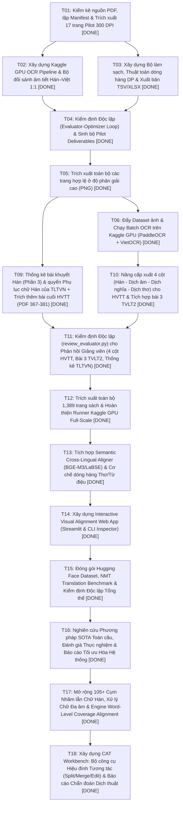

# WAYFINDER — Bản đồ Phụ thuộc Nhiệm vụ (Task Dependency Graph)

- **Tổng số Ticket**: `16` | **DONE**: `16` | **IN_PROGRESS**: `0` | **READY (Mở khóa)**: `0` | **BLOCKED**: `0`
- **Tệp dữ liệu gốc**: [`config/tickets.json`](../config/tickets.json)

## 1. Sơ đồ Phụ thuộc (Mermaid DAG)

## 2. Bảng Điều phối Chi tiết

| Ticket ID | Giai đoạn (Phase) | Nhiệm vụ | Subagent (`owner_agent`) | Phụ thuộc (`depends_on`) | Mở khóa (`unblocks`) | Trạng thái |
| :--- | :--- | :--- | :--- | :--- | :--- | :--- |
| `T01` | Phase 1: Inventory & Image Extraction | **Kiểm kê nguồn PDF, lập Manifest & Trích xuất 17 trang Pilot 300 DPI** | `data_architect` | — | `T02`, `T03` | **`DONE`** |
| `T02` | Phase 2: OCR & Phonetic Verification | **Xây dựng Kaggle GPU OCR Pipeline & Bộ đối sánh âm tiết Hán–Việt 1:1** | `kaggle_ocr_engineer` | `T01` | `T04` | **`DONE`** |
| `T03` | Phase 3: Cleaning, Alignment & QA | **Xây dựng Bộ làm sạch, Thuật toán dóng hàng DP & Xuất bản TSV/XLSX** | `alignment_qa_engineer` | `T01` | `T04` | **`DONE`** |
| `T04` | Phase 4: Independent Review & Pilot Gate | **Kiểm định Độc lập (Evaluator-Optimizer Loop) & Sinh bộ Pilot Deliverables** | `plan_code_reviewer` | `T02`, `T03` | `T05` | **`DONE`** |
| `T05` | Phase 5: Full-Scale Production | **Trích xuất toàn bộ các trang hợp lệ ở độ phân giải cao (PNG)** | `data_architect` | `T04` | `T06`, `T09` | **`DONE`** |
| `T06` | Phase 5: Full-Scale Production | **Đẩy Dataset ảnh & Chạy Batch OCR trên Kaggle GPU (PaddleOCR + VietOCR)** | `kaggle_ocr_engineer` | `T05` | `T10` | **`DONE`** |
| `T09` | Phase 6: Instructor Feedback Integration | **Thống kê bài khuyết Hán (Phần 3) & quyển Phụ lục chữ Hán của TLTVN + Trích thêm bài cuối HVTT (PDF 367-381)** | `data_architect` | `T05` | `T11` | **`DONE`** |
| `T10` | Phase 6: Instructor Feedback Integration | **Nâng cấp xuất 4 cột (Hán - Dịch âm - Dịch nghĩa - Dịch thơ) cho HVTT & Tích hợp bài 3 TVLT2** | `alignment_qa_engineer` | `T06` | `T11` | **`DONE`** |
| `T11` | Phase 6: Instructor Feedback Integration | **Kiểm định Độc lập (review_evaluator.py) cho Phản hồi Giảng viên (4 cột HVTT, Bài 3 TVLT2, Thống kê TLTVN)** | `plan_code_reviewer` | `T09`, `T10` | `T12` | **`DONE`** |
| `T12` | Phase 7: Full-Scale Production Readiness | **Trích xuất toàn bộ 1,389 trang sách & Hoàn thiện Runner Kaggle GPU Full-Scale** | `kaggle_ocr_engineer` | `T11` | `T13` | **`DONE`** |
| `T13` | Phase 8: Enhanced Semantic & Poetic Alignment | **Tích hợp Semantic Cross-Lingual Aligner (BGE-M3/LaBSE) & Cơ chế dóng hàng Thơ/Từ điệu** | `alignment_qa_engineer` | `T12` | `T14` | **`DONE`** |
| `T14` | Phase 9: Interactive Human-in-the-Loop Platform | **Xây dựng Interactive Visual Alignment Web App (Streamlit & CLI Inspector)** | `data_architect` | `T13` | `T15` | **`DONE`** |
| `T15` | Phase 10: Downstream Packaging & Final Gate | **Đóng gói Hugging Face Dataset, NMT Translation Benchmark & Kiểm định Độc lập Tổng thể** | `plan_code_reviewer` | `T14` | `T16` | **`DONE`** |
| `T16` | Phase 11: SOTA Synthesis, Long-running Empirical Verification & Optimization | **Nghiên cứu Phương pháp SOTA Toàn cầu, Đánh giá Thực nghiệm & Báo cáo Tối ưu Hóa Hệ thống** | `plan_code_reviewer` | `T15` | `T17` | **`DONE`** |
| `T17` | Phase 12: Advanced Linguistic Grounding & Word-Level Coverage | **Mở rộng 105+ Cụm Nhầm lẫn Chữ Hán, Xử lý Chữ Đa âm & Engine Word-Level Coverage Alignment** | `alignment_qa_engineer` | `T16` | `T18` | **`DONE`** |
| `T18` | Phase 13: Interactive CAT Workbench & Lexical Diagnostic Engine | **Xây dựng CAT Workbench: Bộ công cụ Hiệu đính Tương tác (Split/Merge/Edit) & Báo cáo Chẩn đoán Dịch thuật** | `alignment_qa_engineer` | `T17` | — | **`DONE`** |

## 3. Bước Kế tiếp Tối ưu Nhất (Next Unblocked Tickets)

- Tất cả các ticket trong DAG đã hoàn tất (`DONE`) hoặc đang chạy.
